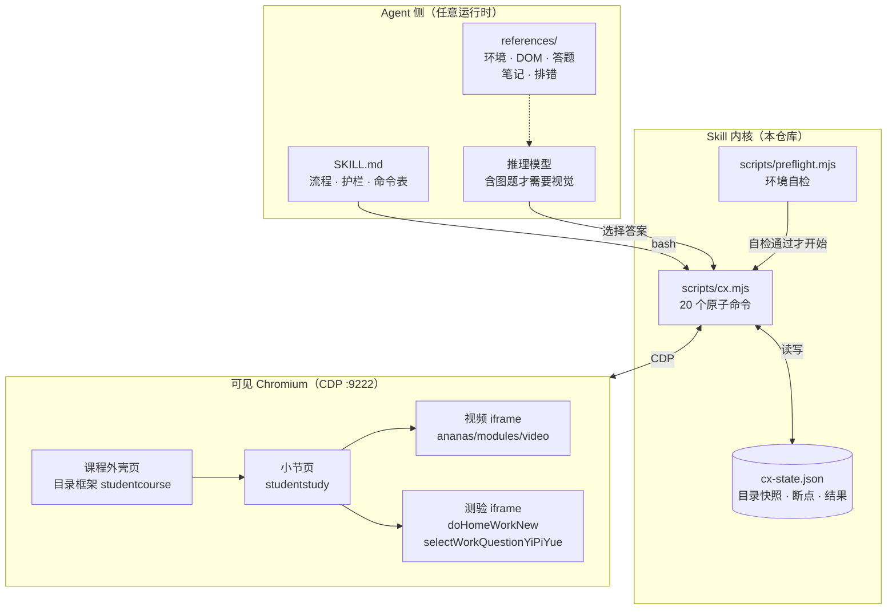
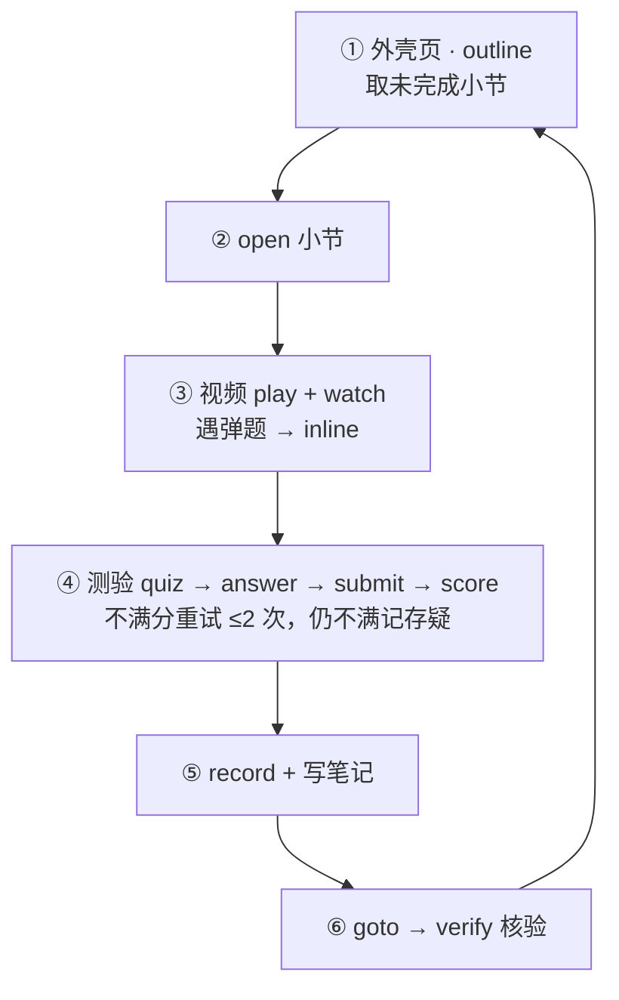

<div align="center">


# chaoxing-course

**超星学习通 · 章节网课推进 Skill**

按目录逐节推进视频与测验任务点，以页面完成标记核验，边做边把题目整理成章节笔记。

<p>
  <a href="LICENSE"></a>
  = 18">
  
  
  
</p>

</div>

---

## 这是什么

一个把「推进超星章节网课」这件事做完整、做可核验的 Skill。它不靠截图点坐标，也不靠录制回放，而是：

- 用一条**命令行长**（`scripts/cx.mjs`）通过 CDP 驱动一个**可见的 Chrome**；
- 每一步都返回**单行 JSON**，短调用、可重试、断点续跑；
- **完成判定以课程目录的完成标记为准**，不信播放器的 `ended`；
- 题目、选项、作答与得分**当场落盘**成章节笔记。

它不绑定任何 agent。只要能执行 bash，就能用它。

> 只做教材与测验任务点。**考试、自测、人脸识别、验证码不在范围内。**

## 特性

| 能力 | 说明 |
|---|---|
| 目录自发现 | `outline` 读出全部小节、完成状态与未完成清单，不靠猜 |
| 视频推进 | 1 倍速、不拖进度条、自动恢复被暂停的播放、卡死自动重进 |
| 弹题处理 | 探测内嵌题弹窗，暂停时返回题面，作答后继续播放 |
| 测验作答 | 读题干与选项，按题型填答并提交，回读逐题得分 |
| 存疑隔离 | 不满分最多重试 2 次，之后记「存疑」并**继续推进**，不阻塞 |
| 断点续跑 | 状态落 `cx-state.json`，进程被杀也能接着做 |
| 选择器单点 | 全部选择器集中在 `SEL`，改版后一处可改 |
| 环境自检 | `preflight.mjs` 逐项 PASS/FAIL 并给修复命令 |

## 架构



一句话：**agent 只做判断，脚本只做操作，浏览器只做呈现。** 三者之间只有 JSON 和 CDP 两种契约。

### 单节循环



## 安装

### 0. 前置

| 依赖 | 版本 |
|---|---|
| Node.js | ≥ 18 |
| Chrome / Edge / Chromium | 需图形界面（登录要扫码，过程要给人看） |

### 1. 放到 skills 目录

<details open>
<summary><b>omp</b></summary>

```bash
git clone https://github.com/Gerchart-GXT/chaoxing-study-skill.git ~/.omp/agent/skills/chaoxing-course
```
</details>

<details>
<summary><b>Claude Code</b></summary>

```bash
git clone https://github.com/Gerchart-GXT/chaoxing-study-skill.git ~/.claude/skills/chaoxing-course
```
</details>

<details>
<summary><b>Codex / 其它 agent</b></summary>

Codex 没有 skills 目录，把它放在任意位置，再在该项目里加一个 `AGENTS.md` 指向 `SKILL.md`：

```bash
git clone https://github.com/Gerchart-GXT/chaoxing-study-skill.git ~/chaoxing-course
printf 'When the task is about Chaoxing (超星学习通) video courses, read and follow:\n~/chaoxing-course/SKILL.md and its references/.\n' >> AGENTS.md
```
</details>

### 2. 装依赖

```bash
cd <skill-dir>/scripts && npm install     # 只装 puppeteer-core，不下载浏览器
```

### 3. 起一个可见的浏览器

```bash
google-chrome --remote-debugging-port=9222 \
  --user-data-dir="$HOME/.cx-chrome" --no-first-run \
  "https://passport2.chaoxing.com/login?fid=&newversion=true&refer=https%3A%2F%2Fi.chaoxing.com"
```

WSL2 下 Chrome 在 Windows 侧，需要额外做一层端口转发，详见 [`references/environment.md`](references/environment.md)。

### 4. 自检

```bash
node <skill-dir>/scripts/preflight.mjs --endpoint http://127.0.0.1:9222
```

`pass: true` 才能继续；否则按输出的 `fix` 字段逐项修。自检项：Node 版本、依赖、浏览器可执行文件、图形界面、调试端口、超星页面、登录态、视觉模型。

### 5. 登录

在浏览器窗口里自己**扫码或账号登录**。脚本不接收、不代填账号密码。

## 交给 Agent 安装

把下面整段粘给任意 agent（Claude Code / Codex / omp / 自建），它会自己完成安装与自检：

```text
请在这台机器上安装并验证 chaoxing-course Skill。

仓库：https://github.com/Gerchart-GXT/chaoxing-study-skill
目标目录：按宿主 agent 的 skills 约定放置（omp: ~/.omp/agent/skills/，Claude Code: ~/.claude/skills/）；
          无 skills 目录的 agent，放到 ~/chaoxing-course 并在项目 AGENTS.md 里加一行指向 SKILL.md。

按顺序执行，任一步失败就停下并报告，不要跳过：
1. git clone 到目标目录。
2. cd <目标目录>/scripts && npm install（只允许装 puppeteer-core）。
3. 读 <目标目录>/SKILL.md 与 references/environment.md，按当前 OS 起一个**可见**的 Chrome：
   --remote-debugging-port=9222 --user-data-dir=<独立目录>
   起始页 https://passport2.chaoxing.com/login?fid=&newversion=true&refer=https%3A%2F%2Fi.chaoxing.com
   若为 WSL2，按 references/environment.md 做 TCP 转发，并用 CX_ENDPOINT 指向转发地址。
4. node scripts/preflight.mjs --endpoint <endpoint>
   要求 pass: true。任一 FAIL：输出该检查项、detail、fix 三条信息后停止。
5. 请用户在弹出的浏览器窗口里自己完成登录；不要索要账号密码。
6. 登录后重跑 preflight，确认 logged-in 为 PASS。
7. 跑 node scripts/cx.mjs where，确认能看到超星页面与框架列表。
8. 报告：安装路径、endpoint、preflight 结果、下一步需要用户提供什么（课程页 URL）。

约束：
- 不要 git add cx-state.json、node_modules 或任何截图。
- 不要修改 scripts/cx.mjs 的 SEL，除非 dom 命令探明了新选择器。
- 本 Skill 不做考试、自测、人脸与验证码环节。
```

## 快速开始

拿到课程页后，单节流程就是一个固定序列：

```bash
export CX_ENDPOINT=http://127.0.0.1:9222
C="node scripts/cx.mjs"

$C mark --url "<课程外壳页 URL>"   # 只需一次，记进 cx-state.json
$C goto                           # 回外壳页
$C outline                        # 拿到未完成小节清单
$C open --name "<小节名>"
$C tab --to 视频 && $C probe && $C play
$C watch --every 30 --checks 4    # 返回 quiz / ended / stall / continue
$C tab --to 测验 && $C quiz       # 读题
$C answer --spec '{"0":[2],"1":[0,2]}' && $C submit && $C score
$C record --name "<小节名>" --data '{"score":100,"verified":true}'
$C goto && $C verify --name "<小节名>"
```

`summary` 汇总「待处理 / 已核验 / 存疑」，用来收尾。

## 命令

| 命令 | 作用 |
|---|---|
| `where` | 当前 URL、标签页、框架列表 |
| `goto [--url U]` | 回课程外壳页并等目录框架就绪 |
| `mark --url U` | 记住课程外壳页 URL |
| `outline` | 读目录：小节数、完成数、未完成清单 |
| `open --name N` | 点进小节，等标题出现 |
| `section` | 当前小节标题、页签 |
| `tab --to 视频\|测验` | 切页签并等框架就绪 |
| `probe` | 视频状态 `{t,d,p,ended,ready,quiz}` |
| `play` | 播放（不改倍速） |
| `watch --every 30 --checks 4` | 轮询观看，返回 `continue`/`quiz`/`ended`/`stall`/`frame-lost` |
| `inline --pick 0` | 答视频内嵌题 |
| `quiz` | 读测验题目与选项 |
| `answer --spec J` | 填答案，不提交 |
| `submit` | 提交并确认弹窗 |
| `score` | 读逐题对错与总分 |
| `verify [--name N]` | 读目录完成标记 |
| `record --name N --data J` | 写状态文件 |
| `summary` | 汇总三类状态 |
| `dom --frame K --grep R` | 探类名（改版时用） |
| `shot --path P` | 截图 |

## 目录结构

```
chaoxing-course/
├── README.md                 # 本文件
├── SKILL.md                  # 主流程：边界、命令、护栏、主循环
├── references/
│   ├── environment.md        # 三平台启动、WSL2 转发、登录、自检项
│   ├── dom.md                # 三种页面模型、框架、选择器、完成判定
│   ├── answering.md          # 答题协议、重试、存疑、题型陷阱
│   ├── notes.md              # 笔记与汇报格式
│   └── troubleshooting.md    # 13 条实测坑
├── scripts/
│   ├── cx.mjs                # 原子操作命令行
│   ├── preflight.mjs         # 环境自检
│   └── package.json
├── assets/chaoxing-mark.png
└── LICENSE
```

## 设计取舍

**为什么是命令行而不是 Skill 里的 JS 片段。** 常驻内核会丢状态：会话一断，函数和变量全没。把函数放进可执行文件、把状态放进 JSON，换 agent 只换一层包装。

**为什么用 CDP 而不是自己管 WebSocket。** `puppeteer.connect({browserURL})` 每次都重新读 `/json/version`，天然躲开「Chrome 重启后 ws id 变了导致 404」这个坑。

**为什么必须回外壳页核验。** 播放器的 `ended` 只说明视频放完了，不说明任务点入账。小节页右栏是另一套 DOM，没有 `catalog_state`。只有课程外壳页的目录才是权威。

## 已知限制

- **平台改版即失效。** 选择器集中在 `SEL`，用 `dom` 现场探后一处可改。
- **答题写入路径未在「待答」状态下回归测试**：首版验证可用的课程已全部完成，没有待答小节。首次使用请先在单个未完成小节上跑通 `quiz → answer → submit → score`。
- **批改页不提供标准答案**，只有我的答案、得分、对错标记。因此满分才等于确认，否则只能记为存疑。
- **不做**考试、自测、人脸识别、验证码、倍速与伪造进度。
- **日志可安全外贴**：`where`/`goto`/`dom`/`preflight` 的 URL 输出已剥掉 query（显示 `?…`）；`mark` 会回显你传入的完整 URL，那条别贴。

## 免责声明

- 本项目仅用于**自动化重复的页面操作**与整理笔记，不绕过任何平台的身份校验、人脸识别或考试环节。
- 部分平台的使用条款可能不鼓励自动化操作。**是否使用、是否被认定为违规，由使用者自行判断并承担全部后果。** 作者不对账号处罚、成绩失效等后果负责。
- 商标：超星、学习通及相关图形标识归超星集团所有，此处仅作**指代性使用**。本项目与超星集团无任何隶属或合作关系。

## License

本项目采用 [MIT](LICENSE) 协议。
