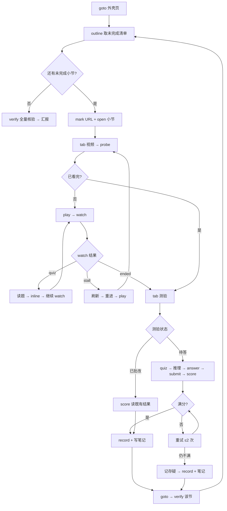

# 超星章节网课推进

按课程目录顺序，把每个小节的**视频任务点**与**测验任务点**做到平台判定完成，边做边把题目整理进笔记。

本 Skill 与 agent 无关：所有页面操作走一个命令行脚本 + CDP，任何能执行 bash 的 agent 都能用。不需要 omp 的常驻内核、todo 或 goal。

## 边界

做：章节视频、视频内嵌题、章节测验、笔记整理、完成核验。

不做：**考试**、自测、错题集、需人脸识别或验证码的环节、修改播放倍速、伪造观看进度。

必须停下来交人的情况：登录、人脸识别、验证码、平台要求"重做测验"而会覆盖已有成绩时。

## 前置

1. 读 `references/environment.md`：起一个**可见**的 Chrome（开 `--remote-debugging-port`），WSL2 需额外端口转发。
2. `node scripts/preflight.mjs` 必须 `pass: true`。
3. 让用户自己在浏览器里登录 `https://passport2.chaoxing.com/login?fid=&newversion=true&refer=https%3A%2F%2Fi.chaoxing.com`。**不要**索要账号密码。
4. 读 `references/dom.md` 了解三种页面与框架结构。

## 命令

全部输出单行 JSON，短返回，适合在循环里反复调用。

| 命令 | 作用 |
|---|---|
| `where` | 当前 URL、标签页、框架列表 |
| `goto [--url U]` | 回课程外壳页（默认用状态里记的 URL），等目录框架就绪 |
| `mark --url U` | 记住课程外壳页 URL |
| `outline` | 读目录：小节数、完成数、未完成清单 |
| `open --name "小节名"` | 点进小节 |
| `section` | 当前小节标题、页签、是否已完成 |
| `tab --to 视频\|测验` | 切页签并等框架就绪 |
| `probe` | 视频状态 `{t,d,p,ended,ready,quiz}` |
| `play` | 播放（不改倍速） |
| `watch --every 30 --checks 4` | 轮询观看，返回 `continue`/`quiz`/`ended`/`stall`/`frame-lost` |
| `inline --pick 0` | 答视频内嵌题（下标 0 起） |
| `quiz` | 读测验题目与选项 |
| `answer --spec '{"0":[2]}'` | 填答案（不提交） |
| `submit` | 提交并确认弹窗 |
| `score` | 读批改结果与总分 |
| `verify [--name N]` | 读目录完成标记 |
| `record --name N --data J` | 写状态文件 |
| `summary` | 汇总待处理 / 已核验 / 存疑 |
| `dom --frame K --grep R` | 探类名，改版时用 |
| `shot --path P` | 截图 |

环境变量：`CX_ENDPOINT`（默认 `http://127.0.0.1:9222`）、`CX_STATE`（默认 `cx-state.json`）。

## 主循环



单节固定顺序，不要跳步：

1. 外壳页 `outline`，拿到未完成小节清单（不是靠印象）。
2. `open` 进小节。
3. 视频：`tab --to 视频` → `probe` → 未看完则 `play` + `watch` 循环。
4. `watch` 返回 `quiz` → 读题作答 → 继续 `watch`，直到 `ended`。
5. 测验：`tab --to 测验` → 若 `quiz` 返回 `frame: graded` 则该节已做过，直接 `score` 读结果。
6. `submit` 后 `score` 读分；不满分重试 ≤2 次，仍不满记存疑。
7. `record` + 写笔记。
8. `goto` 回外壳页 → `verify --name` 确认该节变绿。**核验不过就刷新的重试一次，仍不过则不推进下一节，先报告。**

## 护栏

| 护栏 | 说明 |
|---|---|
| 1 倍速 | 不设 `playbackRate`，不拖进度条 |
| 窗口可见 | 用户要能随时看到并介入 |
| 单人单标签 | 不多开、不并发播多个视频 |
| 短调用 | 单次 `watch` ≤ 2 分钟，避免工具超时 |
| 完成以目录为准 | 播放器 `ended` 不算完成，必须 `verify` 通过 |
| 存疑不阻塞 | 答错只记录，不中断后续 |
| 登录不代劳 | 不接收、不输入账号密码 |

## 选择器漂移

选择器集中在 `scripts/cx.mjs` 的 `SEL`。**发现取不到数据时，先 `dom` 探，再改 `SEL`，不要硬试**：

```bash
cx.mjs dom --frame ananas --grep 'video|quiz'
cx.mjs dom --grep 'catalog|chapter|state'
cx.mjs shot --path /tmp/x.png --full
```

已经踩过的坑（页签 `li`/`div` 两种、对错标记 `fr.dui`/`marking_dui` 两套、外壳页 `t` 参数不可改写）都在 `references/troubleshooting.md`。

## 视觉模型

只有在**题干或选项含图片/公式**、或 DOM 抽取失败时才需要。默认路径是纯文本：

```bash
cx.mjs quiz          # 文本题干与选项
cx.mjs shot --path /tmp/q.png   # 仅在文本不足时
```

当前模型不支持看图时，遇到必须看的图，直接标存疑，不要猜。

## 记录

每小节完成即写盘，格式见 `references/notes.md`。存疑项只出现在两处：该章节的 md 与最终汇报，不影响继续推进。

## 汇报

用 `cx.mjs verify` 的实际数字，不用印象。列出：完成数/总数、分数分布、存疑清单（含原因）、未做的事（考试等）。

## 隐私

课程外壳 URL 含 `cpi`/`enc`/`t` 令牌，等同会话凭据：只进 `cx-state.json`，不进 Skill、笔记、提交记录。笔记里只写课程结构，不写学校名、单位名、课程 id。

`where`/`goto`/`preflight`/`dom` 打印 URL 时已自动去掉 query（显示为 `?…`），因此日志可以直接贴到 issue。`mark` 会原样回显你传入的 URL，那条输出不要外贴。`dom` 还会带回 200 字页面文本，贴之前看一眼。
