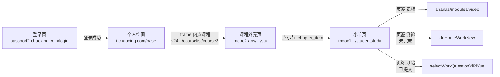

# 页面模型与选择器

超星章节课有三种页面，搞混会直接读不到数据。**先判断在哪一页，再选命令**。



| 页面 | 能做什么 | 不能做什么 |
|---|---|---|
| 课程外壳页（含 `studentcourse` 框架） | `outline`、`verify`、`open` | 播放、答题 |
| 小节页 | `section`、`tab`、`probe`、`play`、`watch`、`inline`、`quiz`、`answer`、`submit`、`score` | `outline`、`verify`（目录是另一套 DOM，没有 `.catalog_state`） |
| 个人空间 | 找课程入口 | 其它 |

## 课程外壳页的 URL 不可拼装

外壳页 URL 形如：

```
https://mooc2-ans.chaoxing.com/mooc2-ans/mycourse/stu
  ?courseid=…&clazzid=…&cpi=…&enc=…&t=…&pageHeader=1&v=0&hideHead=0
```

- `t` **不是**时间戳缓存参数。实测：沿用捕获到的旧值可以反复进入；把 `t` 换成当前毫秒时间戳，页面直接显示「无效的参数」，子框架不生成。
- `enc` 在外壳页与 `studentstudy` 页**不是同一个值**，不能互相搬运。
- 结论：外壳页 URL 必须现场捕获一次，存入 `cx-state.json`（`cx.mjs mark --url "<url>"`），之后 `cx.mjs goto` 复用。捕获方式：从个人空间点课程，落到外壳页后 `cx.mjs where` 读 `url`。

## 框架结构

| 框架 URL 子串 | 内容 | 选择器 |
|---|---|---|
| `studentcourse` | 章节目录 | `.chapter_item`、`.catalog_state`、`.icon_yiwanc` |
| `ananas/modules/video` | 视频与内嵌题 | `video`、`.ans-videoquiz`、`.ans-videoquiz-opt`、`.ans-videoquiz-submit` |
| `doHomeWorkNew` | 待答测验 | `.TiMu`、`li[role=radio]`、`li[role=checkbox]` |
| `selectWorkQuestionYiPiYue` | 已批改结果 | `.TiMu`、`.dui`/`.cuo`、`.Py_answer` |

## 目录结构与完成判定

- 单元标题和小节标题**都是** `.chapter_item`，两者混在同一个列表里（某一门课实测 83 个，其中只有 68 个是真小节）。
- 区分方法：有 `.catalog_state` 的是小节，没有且首个子元素含 `chapter_Thats_bnt` 的是单元。
- 单元标题的 `title` 属性为空，名字只能从 `innerText` 取。
- 完成标记：`.catalog_state.icon_yiwanc`，其内 `.bntHoverTips` 文本为 `Completed`。页面顶部另有一处 `Tasks Completed: x/y` 的汇总文本。
- **完成判定必须用外壳页的目录**，不要用播放器的 `ended`，也不要用小节页的右栏（那套 DOM 没有 `catalog_state`）。

## 小节页

- 标题：`.prev_title` 的 `innerText`。注意 `document.title` 是无意义的 `A students learning progress`，`h1` 也可能命中别处。
- 页签：文本为 `视频` / `测验`，历史上既可能是 `li` 也可能是 `div`，**不要按标签名选**，按文本匹配。
- "任务点已完成"横幅在子框架里，主框架读不到。

## 视频探针

```js
{ t, d, p, ended, ready, rate, quiz }
```

- `t`/`d` 为当前时间与总时长，`p` 为暂停，`ended` 为结束，`ready` 为 `readyState`。
- 视频未加载时 `d` 为 `null`、`ready` 为 `0`，这是正常态，不要当成错误。
- `quiz` 非空表示内嵌题弹窗可见，取值是弹窗文本。

## 内嵌题

- 容器 `.ans-videoquiz`，选项 `.ans-videoquiz-opt`（内含 `input` 与 `label`），提交 `.ans-videoquiz-submit`。
- 选项顺序即 DOM 顺序，判断题第 0 项为"对/True"。
- 判错后可重选再提交，实测不影响任务点完成。

## 测验题

- 题目容器 `.TiMu`，题干在 `.qtContent`。
- 选项 `li[role=radio]`（单选）或 `li[role=checkbox]`（多选）。勾选要点 `label`，点 `input` 无效。
- 提交按钮文本为 `Submit` 或 `提交`，之后可能弹确认框，按钮文本 `OK`/`确定`/`确认`。
- 题型在题干前的 `【Single Choice】`/`【Multiple Choice】`/`【True or False】`。

## 对错标记有两套

同一门课的不同小节会返回不同版本的批改页：

| 版本 | 正确 | 错误 |
|---|---|---|
| A | `i.fr.dui` | `i.fr.cuo` |
| B | `span.marking_dui` | `span.marking_cuo` |

`SEL.markRight` / `SEL.markWrong` 已经写成交集选择器。**只看 `.dui` 会漏判版本 A 之外的情况，只看 `.marking_dui` 会漏判另一版**。

## 批改页不给标准答案

已批改页面只提供：我的答案、得分、对/错标记。**没有任何字段包含标准答案**。所以：

- 得分满分 ⇒ 可以确认该题内容正确。
- 得分不满 ⇒ 只知道错了，不知道正确答案是什么。
- 不要假装知道正确答案。

## 改版时怎么重新探

```bash
cx.mjs dom --frame ananas --grep 'video|quiz'   # 只看视频框架里的相关类名
cx.mjs dom --grep 'catalog|chapter|state'       # 看目录
cx.mjs shot --path /tmp/a.png --full            # 目视确认
```

拿到新类名后改 `scripts/cx.mjs` 顶部的 `SEL`。所有选择器集中在那一处，改一个地方即可。
